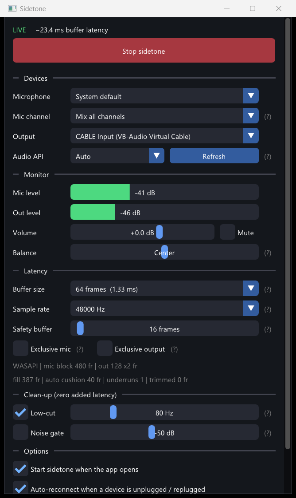

# Sidetone

Hear your own microphone in your headphones with the **lowest latency your hardware allows** — on Windows, macOS and Linux.



## Download

Grab the latest build from **[Releases](../../releases/latest)**:

| OS | File | Run |
|---|---|---|
| Windows 10/11 (x64) | `Sidetone-windows-x64.zip` | unzip, run `Sidetone.exe` (single portable exe, no install) |
| macOS 10.15+ (Intel + Apple Silicon) | `Sidetone-macos-universal.zip` | unzip, right-click `Sidetone.app` → **Open** the first time (unsigned), allow microphone access |
| Linux x64 | `Sidetone-linux-x64.tar.gz` | `tar xzf …` then `./Sidetone` |

## Features

- Pick **any microphone** and **any output** (headset, speakers, virtual cable…), switch live
- Volume (-40…+24 dB), mute, left/right balance, mic channel select (for one-sided USB mics)
- **Low-latency engine**
  - miniaudio with low-latency profile, no fixed-size callback buffering, real-time audio threads (MMCSS "Pro Audio" on Windows)
  - Windows: IAudioClient3 low-latency shared mode when the driver supports it, optional **exclusive mode** per device
  - Linux: ALSA / PulseAudio / PipeWire / **JACK** selectable; macOS: CoreAudio
  - Lock-free ring buffer between mic and output with **drift control**: a mic and headset run on separate clocks, so latency normally creeps up over time — Sidetone continuously trims any backlog (inaudibly) so latency stays at the minimum, forever
  - Adaptive jitter cushion: grows only when an underrun actually happens, shrinks back when stable
- Live stats: estimated latency, real driver block sizes, buffer fill, underruns
- Zero-latency clean-up: low-cut filter and noise gate
- Auto-reconnect when a USB device is unplugged/replugged, start on launch, always-on-top
- Settings saved automatically
- Command line / headless mode

## Getting the lowest latency

1. Set **Buffer size** as low as it goes without crackles (start at 64, try 32).
2. Keep the sample rate at your devices' native rate (usually 48000 Hz).
3. Windows: **Exclusive output** on a dedicated endpoint (e.g. a headset's separate *chat* device) cuts latency a lot. Exclusive mic blocks Discord/games from that mic, so only use it if you don't need the mic elsewhere.
4. Linux: choose **JACK** as the Audio API (works with PipeWire's JACK layer).
5. Watch the stats line: *mic block* / *out* show what the driver actually granted.

**About "zero latency":** no software path is truly zero — audio must be captured in blocks and played in blocks. Typical results: ~3–10 ms with JACK / CoreAudio / exclusive WASAPI on good interfaces; ~15–40 ms in Windows shared mode with many USB headsets (Windows' own engine period is 10 ms per direction for drivers without low-latency support). If your headset has **hardware sidetone** (set in its own app), that one is truly zero-latency and should be preferred.

## Command line

```
Sidetone --list                      # list audio APIs, mics and outputs
Sidetone --headless                  # run without a window using saved settings
    --input "name" --output "name" --period 32 --rate 48000 --gain -6
    --exclusive | --exclusive-in | --exclusive-out   --backend JACK
```

Settings live in `%APPDATA%\Sidetone\settings.ini` (Windows), `~/Library/Application Support/Sidetone/` (macOS), `~/.config/sidetone/` (Linux).

## Build from source

Needs CMake 3.16+ and a C++17 compiler. Dependencies (GLFW, Dear ImGui, miniaudio) are fetched automatically.

```bash
cmake -S . -B build -DCMAKE_BUILD_TYPE=Release
cmake --build build --config Release
```

Linux packages: `libx11-dev libxrandr-dev libxinerama-dev libxcursor-dev libxi-dev libgl1-mesa-dev`.

## License

MIT
